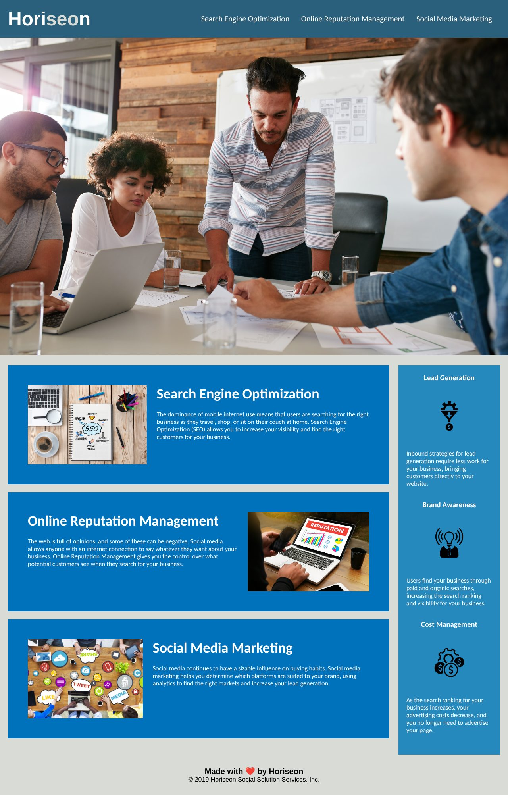

<h1 align="center">📈 Horiseon Marketing: Code Refactor</h1>

<p align="center">An accessibility and SEO refactor of the landing page for Horiseon, a fictional digital-marketing agency.</p>

<p align="center">
  
  
</p>

<p align="center"></p>

## Refactor Progress

Done:

- Every image has descriptive `alt` text
- The page has semantic `<header>` and `<footer>` elements

Still to do:

- Replace the remaining `<div>` wrappers with semantic elements: `<nav>`, `<main>`, `<section>` and `<aside>`

## Page Sections

- Navigation linking to each service section
- Services:
  - Search Engine Optimization
  - Online Reputation Management
  - Social Media Marketing
- Benefits sidebar:
  - Lead Generation
  - Brand Awareness
  - Cost Management

## Built With

- HTML5
- CSS3

## Running Locally

No build step is needed.

1. Clone the repo:
   ```bash
   git clone https://github.com/ChristianKrantz11/horiseon-challenge.git
   ```
2. Open `index.html` in your browser.

## Author

[ChristianKrantz11](https://github.com/ChristianKrantz11)
